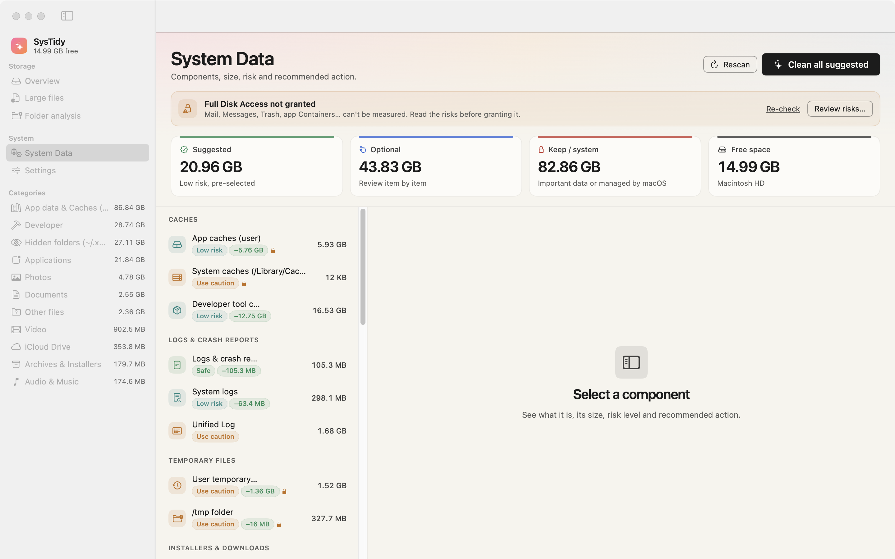

# SysTidy – System Data Cleaner for Mac

SysTidy shows what is inside the grey "System Data" bar in macOS Storage settings: caches, logs, temporary files, installers, developer tools, backups and app data. Each item comes with its size, a risk level and a recommended action, so you decide what to remove.

**[Download on the Mac App Store](https://apps.apple.com/app/id6835868083)** · [systidy.com](https://systidy.com)

## Support

Questions, bug reports or feature ideas: **tongduoctuvien@gmail.com**

Please include your macOS version and, for bugs, what you were doing when it happened.

## Frequently asked questions

**Why does SysTidy ask me to choose my Home folder?**
Apps from the Mac App Store run in a sandbox. Choosing your Home folder once lets SysTidy measure caches, logs and app data inside `~/Library`. The permission is remembered; you can revoke it by deleting the app.

**Why can't SysTidy see Mail, Messages or the Trash?**
macOS protects those folders. You can grant SysTidy Full Disk Access in System Settings › Privacy & Security › Full Disk Access. It is optional, and SysTidy explains the risks before you do it.

**Why do some items show a command instead of a Delete button?**
Some parts of System Data, such as local Time Machine snapshots or the Spotlight index, can only be changed by macOS tools. SysTidy copies the right command so you can review it and run it in Terminal yourself.

**Does SysTidy delete anything on its own?**
No. Nothing is removed until you select items and confirm. You choose the Trash or permanent deletion each time.

**What is SysTidy Pro?**
SysTidy Pro is not available yet; it arrives in version 1.1. The current version 1.0 is free with no cleaning limit. From 1.1, scanning, explanations, risk levels and folder diagnosis stay free and the free version cleans up to 5 GB in total. Pro will be a one-time purchase (not a subscription) that adds unlimited cleaning, "Clean all suggested" in one click, scan history showing exactly what grew, alerts when System Data balloons, and cleanup of node_modules, virtual environments and build folders in projects you haven't touched. It supports Family Sharing.

**How do I restore my purchase? (from version 1.1)**
Open Settings › SysTidy Pro › Restore purchase, signed in with the same Apple ID.

**Does SysTidy collect my data?**
No. See the [Privacy Policy](privacy.html).

---

# Hỗ trợ (Tiếng Việt)

SysTidy cho bạn thấy phần "System Data" màu xám trong Cài đặt › Dung lượng gồm những gì: cache, log, tệp tạm, bộ cài, công cụ lập trình, sao lưu và dữ liệu ứng dụng, kèm dung lượng, mức rủi ro và gợi ý xử lý.

Góp ý, báo lỗi hoặc đề xuất tính năng: **tongduoctuvien@gmail.com**

- **Chọn thư mục Home:** app App Store chạy trong sandbox, cần bạn chọn thư mục Home một lần để đo cache và log.
- **Mail, Tin nhắn, Thùng rác:** cần cấp quyền Truy cập toàn bộ ổ đĩa (không bắt buộc).
- **SysTidy Pro (có từ bản 1.1, hiện chưa bán):** mua một lần (không phải thuê bao): dọn không giới hạn, Dọn tất cả đề xuất, lịch sử quét, cảnh báo tăng trưởng, dọn dự án lập trình. Bản 1.0 hiện tại miễn phí, không giới hạn dọn; từ 1.1 bản miễn phí dọn tổng cộng 5 GB.
- **Không tự xóa:** SysTidy chỉ xóa khi bạn chọn và xác nhận; mỗi lần bạn chọn Thùng rác hoặc xóa vĩnh viễn.

[Chính sách quyền riêng tư](privacy.html)
